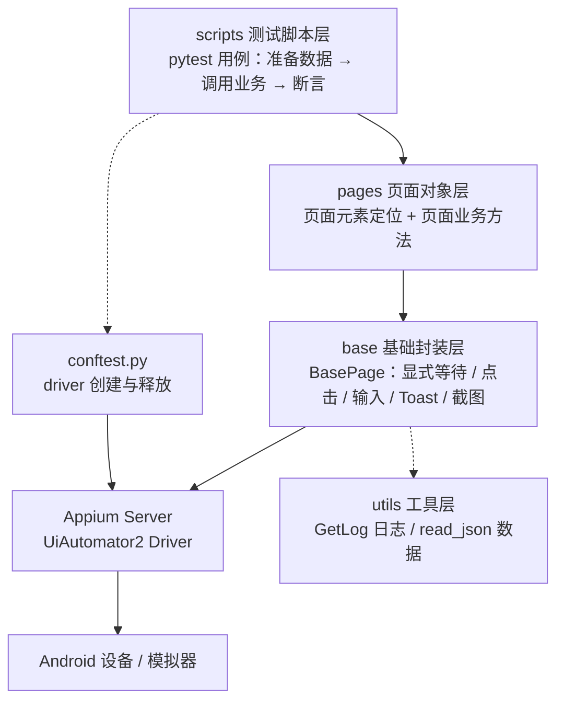

# 严选 App UI 自动化测试项目

> 基于 **Appium + Pytest + Page Object + Allure** 搭建的 Android UI 自动化测试项目，覆盖网易严选 App 的**启动引导、登录、搜索、加入购物车、下单**核心链路。


---

## 一、项目简介

本项目以网易严选 Android 客户端为被测对象，采用经典三层结构（**base 基础封装层 / pages 页面对象层 / scripts 测试脚本层**）组织代码，做了以下几件事：

- **页面元素与业务逻辑解耦**：元素定位器与页面操作全部收敛在 `pages/`，UI 改版只需改一处
- **驱动生命周期统一管理**：`conftest.py` 用 fixture 管理"首次启动"与"带缓存启动"两类驱动，供用例通过参数声明式复用
- **公共能力下沉**：显式等待、点击、输入、获取文本、Toast 捕获、截图、滑动统一封装在 `BasePage`
- **数据驱动**：登录用例通过 JSON + `pytest.mark.parametrize` 驱动多条数据
- **可观测性**：`TimedRotatingFileHandler` 按天切割日志，关键节点自动截图，Allure 输出可视化报告

---

## 二、测试对象与环境

| 项目 | 说明 |
| --- | --- |
| 被测应用 | 网易严选 Android 版（`com.netease.yanxuan`） |
| 启动页 | `.SplashActivityDefault` |
| 系统版本 | Android 12 |
| 运行设备 | MuMu 模拟器（实例 1，900 × 1600，竖屏） |
| 连接方式 | `adb connect 127.0.0.1:16416` |
| 自动化引擎 | UiAutomator2 |

> 真机同样适用，只需把 `config.py` 中的 `platformVersion`、`deviceName` 与 Appium 连接地址改成实际值。

---

## 三、技术栈

| 分类 | 组件 | 版本 |
| --- | --- | --- |
| 语言 | Python | 3.10.10 |
| 自动化框架 | Appium Server | 3.9.0 |
| 驱动 | appium-uiautomator2-driver | 8.7.3 |
| 客户端 | Appium-Python-Client | 6.1.5 |
| 底层协议库 | selenium | 4.52.0 |
| 测试框架 | pytest | 9.2.0 |
| 报告 | allure-pytest / allure-commandline | 2.16.2 / 2.46.1 |
| 运行时 | Node.js（Appium 依赖） | 22.x LTS |

---

## 四、目录结构

```
pythonProjectM2/
├── base/                       # 基础封装层
│   ├── __init__.py             #   日志器初始化（全项目共享）
│   └── base_page.py            #   BasePage：元素定位、点击、输入、Toast、截图、滑动
├── pages/                      # 页面对象层（Page Object）
│   ├── enter_home_page.py      #   启动引导页：协议弹窗、跳过
│   ├── login_page.py           #   登录页：个人中心 → 更多 → 邮箱登录
│   ├── search_page.py          #   搜索页：搜索框、搜索按钮、结果校验
│   ├── cart_page.py            #   商品详情/购物车页：加购、返回首页
│   └── order_page.py           #   购物车/结算页：结算、提交订单
├── scripts/                    # 测试脚本层（pytest 用例）
│   ├── test_home_page.py       #   首页进入
│   ├── test_login.py           #   登录：成功 / 密码错误 / 账号格式错误
│   ├── test_login_ex.py        #   登录：JSON 数据驱动
│   ├── test_search.py          #   搜索
│   ├── test_add_cart.py        #   加入购物车
│   ├── test_order.py           #   结算下单
│   └── test_add_cart_ex.py     #   加购（复用 search_ok 前置）
├── data/
│   └── login_data.json         # 登录用例测试数据
├── utils/
│   └── tools.py                # 日志器 GetLog、JSON 读取 read_json
├── img/                        # 运行截图输出目录
├── log/                        # 运行日志输出目录（按天切割）
├── report/                     # Allure 原始结果输出目录
├── config.py                   # 项目配置：Appium 地址、设备能力、APP 能力
├── conftest.py                 # 驱动前后置 fixture
├── pytest.ini                  # pytest 配置：addopts / testpaths / 命名规则
└── requirements.txt            # 依赖清单
```

---

## 五、框架分层设计



### 5.1 base 层：只做"能力封装"，不含业务

| 方法 | 作用 | 关键点 |
| --- | --- | --- |
| `fd_element` / `fd_elements` | 定位单个 / 多个元素 | `WebDriverWait` 显式等待，默认 10s |
| `base_click` | 点击元素 | 内部复用 `fd_element`，自带等待 |
| `base_input_text` | 输入文本 | 先 `clear()` 再 `send_keys()` |
| `base_get_text` | 获取元素文本 | 用于结果断言 |
| `base_get_toast` | 捕获 Toast 文案 | `presence_of_element_located` + `poll_frequency=0.1` |
| `base_get_shot` | 截图 | 文件名带时间戳，落 `img/` |
| `is_element_exist` | 判断元素是否存在 | 不抛异常，用于可选弹窗 |
| `base_swipe` | 按坐标滑动 | 坐标与时长可配 |

### 5.2 pages 层：元素定位与业务动作

每个页面类继承 `BasePage`，`__init__` 中集中声明定位器，方法只描述"用户在这个页面做了什么"：

```python
class CartPage(BasePage):
    def add_cart(self):
        self.base_click(self.cart_btn1)   # 点击"加入购物车"
        self.base_click(self.cart_btn2)   # 确认按钮
```

用例侧因此可以写成近乎自然语言的链式调用，元素变化时只改 `pages/`。

### 5.3 conftest 层：驱动的前置与后置

| fixture | 启动方式 | 用途 | 收尾动作 |
| --- | --- | --- | --- |
| `first_app_driver` | 无缓存启动（含引导页） | 首次启动、登录类用例 | 关闭 APP + `quit()` |
| `app_driver` | `noReset=True`，保留登录态 | 搜索、加购、下单 | 关闭 APP + `quit()` |
| `login_ok` | 依赖 `first_app_driver` | 登录前置，登录后关闭 APP 以落盘登录态 | 由上层 fixture 统一释放 |
| `search_ok` | 依赖 `app_driver` | 搜索前置，返回可直接操作的 driver | 由 `app_driver` 统一释放 |

用例通过参数声明依赖，无需关心驱动怎么来、怎么关：

```python
def test_add_cart(self, login_ok, search_ok):
    ...
```

---

## 六、用例清单

| 模块 | 用例 | 断言点 / 校验点 | 说明 |
| --- | --- | --- | --- |
| 首页 | `test_enter_home` | 跳过引导、进入首页 | 冒烟用例 |
| 登录 | `test_01_login_success` | 个人中心昵称包含"用户" | 正向 |
| 登录 | `test_02_login_fail_pwd_error` | Toast 包含"账号或密码错误" | 逆向 |
| 登录 | `test_03_login_fail_username_error` | Toast 包含"账号格式错误" | 逆向 |
| 登录 | `test_00_login`（数据驱动） | `data/login_data.json` 中 `expect_result` | 3 组数据 |
| 搜索 | `test_search_success` | 搜索结果标题包含关键词 | 正向 |
| 购物车 | `test_add_cart` | Toast 包含"加入购物车成功" | 核心链路 |
| 订单 | `test_order` | 进入结算页并提交订单，截图留档 | 核心链路 |

> `pytest.ini` 中的 `python_files` 指定了默认执行的模块（`test_add_cart.py`、`test_order.py`），用于日常快速回归；其它模块可通过文件路径直接指定执行，见下方命令。

---

## 七、快速上手

### 7.1 环境要求

- Python 3.10+
- Node.js 18+（Appium Server 运行依赖）
- Appium Server 2.x / 3.x 及 `uiautomator2` 驱动
- Android SDK Platform Tools（`adb` 可用）
- 一台 Android 6.0+ 设备或模拟器
- JDK 8+（仅 Allure 生成报告需要）

```bash
# 安装 Appium 及 Android 驱动
npm install -g appium
appium driver install uiautomator2
```

### 7.2 安装依赖

```bash
# 建议使用虚拟环境
python -m venv .venv
.venv\Scripts\activate          # Windows
# source .venv/bin/activate     # macOS / Linux

pip install -r requirements.txt
```

### 7.3 启动模拟器与 Appium

```bash
# 1. 启动模拟器后确认设备已连接（端口以实际为准）
adb connect 127.0.0.1:16416
adb devices

# 2. 确认系统版本与 config.py 中的 platformVersion 一致
adb shell getprop ro.build.version.release

# 3. 启动 Appium Server（保持窗口开启）
appium -p 4723
```

### 7.4 执行用例

```bash
# 默认执行 python_files 指定的模块
pytest

# 执行单个模块
pytest scripts/test_login.py -v

# 执行单个用例
pytest "scripts/test_add_cart.py::TestCart::test_add_cart" -v

# 执行并清理上一轮的 Allure 结果（--alluredir 已写在 pytest.ini 中）
pytest --clean-alluredir
```

### 7.5 查看报告

```bash
# 启动本地服务并自动打开浏览器
allure serve report

# 或生成静态报告
allure generate report -o report/html --clean
```

---

## 八、日志、截图与报告

| 产物 | 位置 | 说明 |
| --- | --- | --- |
| 运行日志 | `log/app-YYYYMMDD.log` | 按天切割，保留 3 天；格式含时间、级别、文件名、函数名、行号 |
| 运行截图 | `img/<场景>_<时间戳>.png` | 每个用例的关键节点自动截图，命名带场景标识 |
| Allure 结果 | `report/` | `allure serve report` 可视化查看 |
| pytest 缓存 | `.pytest_cache/` | 无需提交 |

日志样例：

```
2026-11-11 15:20:17,176 INFO [base_page.py(base_get_toast:75)] - 获取Toast提示: 加入购物车成功
2026-11-11 15:20:17,176 INFO [test_add_cart.py(test_add_cart:18)] - 添加购物车结果: 加入购物车成功
```

---

## 九、关键实现要点

1. **显式等待优先**：所有元素操作都经过 `WebDriverWait`，不使用固定 `sleep` 作为主要等待手段，减少偶发失败。
2. **Toast 定位**：Toast 属于瞬时控件，用 `presence_of_element_located`（存在即可）而非 `visibility_of_element_located`（等待可见会超时），并把轮询间隔调到 0.1s。
3. **可选弹窗守卫**：`is_element_exist` 返回布尔值不抛异常，用于"位置权限弹窗""新人礼包浮层"这类时有时无的干扰元素。
4. **登录态复用**：`noReset=True` + 登录后关闭 APP，使后续 `app_driver` 启动即处于已登录状态，避免每条用例重复登录。
5. **日志单例**：`GetLog` 用类属性缓存 logger，保证全项目只有一个 handler，不会出现日志重复写入。

---

## 十、踩坑记录

| 现象 | 定位过程 | 结论与解决 |
| --- | --- | --- |
| `Unable to perform W3C actions`，logcat 报 `Input event injection from pid failed` | 对比 `driver.swipe`、`ActionBuilder`、`driver.tap`、`mobile: swipeGesture`、`adb input swipe` 多组实验 | 高版本 Android 镜像限制了低层输入注入；更换为 Android 12 镜像后全部手势恢复正常 |
| `InvalidSessionIdException: A session is either terminated or not started` | 查看日志发现用例主体已通过，异常发生在 fixture 收尾 | 同一设备上同时存在两个 session 时，后启动的 session 会重启 uiautomator2 server，导致前一个 session 失效；应从设计上保证同一时刻只有一个 session 存活 |
| Toast 始终取不到文本 | 换成 `visibility_of_element_located` 依旧超时 | Toast 渲染在系统层且存活时间短，必须用 `presence_of_element_located` 并缩短轮询间隔 |
| `get_window_size()` 返回宽高与 `adb shell wm size` 相反 | 对比两者输出 | 坐标计算统一以 `adb shell wm size` 为准，横竖屏不要混用 |

---

## 十一、已知限制与后续规划

**当前限制**

- 仅适配单一分辨率（900 × 1600），坐标相关操作为硬编码值
- 断言依赖中文文案，App 文案变更会导致用例失效
- 报告暂未使用 `@allure.feature / story / step` 做用例分组与步骤拆解
- 失败用例未自动截图，现场还原依赖日志

**规划中**

- [ ] 失败自动截图并通过 `allure.attach` 挂到报告
- [ ] 补充 `@allure` 装饰器，按模块组织报告目录
- [ ] 坐标改为按屏幕宽高比例计算，适配多分辨率
- [ ] 引入 `pytest-rerunfailures` 处理偶发失败
- [ ] 接入 Jenkins / GitHub Actions 做每日定时回归
- [ ] 测试账号与密码改用环境变量注入，避免明文入库

---

## 十二、声明

本项目仅用于个人自动化测试技术学习与实践，被测应用版权归网易严选所有。仓库中的账号、密码等敏感信息均为占位示例，请勿用于任何商业用途。
